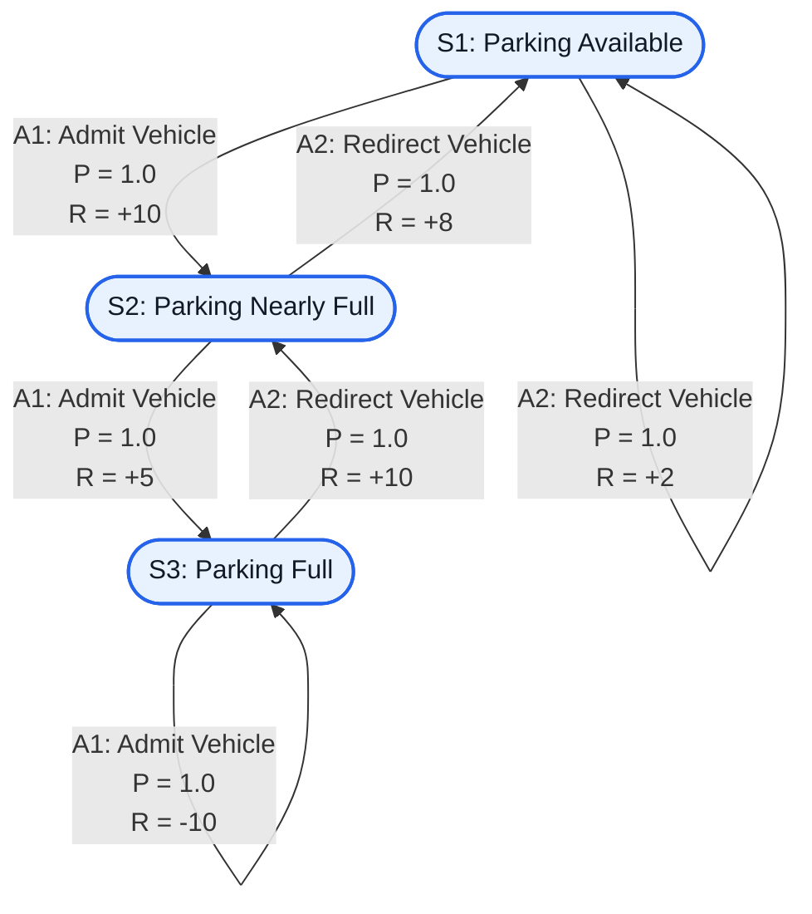

# Smart Parking Space Management Using Markov Decision Process (MDP)

## Aim

To identify a real-world sequential decision-making problem and represent it formally as a Markov Decision Process (MDP) by defining its states, actions, transition probabilities, reward function, and Python representation without discounting future rewards.

---

## Problem Statement

### Problem Description

Parking space management is a common problem in colleges, shopping malls, hospitals, and commercial buildings. Drivers often struggle to find available parking spaces, resulting in unnecessary delays and traffic congestion.

A Smart Parking Space Management System uses information about parking availability to decide whether to admit an incoming vehicle or redirect it to an alternative parking facility.

The system observes the current parking condition and selects an appropriate action. It receives a reward or penalty based on the effectiveness of its decision.

The problem is modeled as a Markov Decision Process with three states:

1. Parking Available
2. Parking Nearly Full
3. Parking Full

The system has two possible actions:

1. Admit Vehicle
2. Redirect Vehicle

The objective is to maximize the total accumulated reward by managing parking capacity efficiently and preventing vehicles from entering when no spaces are available.

The discount factor is set to **γ = 1**, meaning future rewards are not discounted.

---

## MDP Components

A Markov Decision Process is represented as:

$$
MDP = (S, A, P, R, \gamma)
$$

Where:

| Symbol | Meaning                         |
| ------ | ------------------------------- |
| `S`    | Set of states                   |
| `A`    | Set of actions                  |
| `P`    | Transition probability function |
| `R`    | Reward function                 |
| `γ`    | Discount factor                 |

The components used in this project are:

| Component        | Description                              |
| ---------------- | ---------------------------------------- |
| State space      | 3 states                                 |
| Action space     | 2 actions                                |
| Transition model | Deterministic                            |
| Reward function  | Based on parking availability management |
| Discount factor  | γ = 1                                    |

---

## State Space

The state space represents the possible parking conditions in the parking facility.

```text
S = {
    S1: Parking Available,
    S2: Parking Nearly Full,
    S3: Parking Full
}
```

### State Descriptions

| State | Description                                                      |
| ----- | ---------------------------------------------------------------- |
| S1    | Parking Available: Several parking spaces are vacant.            |
| S2    | Parking Nearly Full: Only a few parking spaces remain available. |
| S3    | Parking Full: No parking spaces are available.                   |

These three states represent the parking occupancy conditions observed by the decision-making agent.

---

## Sample State

A sample state is:

```text
S2: Parking Nearly Full
```

This state represents a parking facility where only a few spaces remain vacant.

The system must decide whether to admit an incoming vehicle or redirect it to another parking facility.

---

## Action Space

The action space defines the possible actions available to the parking management system.

```text
A = {
    A1: Admit Vehicle,
    A2: Redirect Vehicle
}
```

### Action Descriptions

| Action | Description                                                                      |
| ------ | -------------------------------------------------------------------------------- |
| A1     | Admit Vehicle: Allow an incoming vehicle to enter the parking facility.          |
| A2     | Redirect Vehicle: Direct an incoming vehicle to an alternative parking facility. |

The system chooses an action according to the current parking condition.

---

## Sample Action

A sample action is:

```text
A2: Redirect Vehicle
```

When the parking facility is full, the system selects Redirect Vehicle to prevent unnecessary entry attempts and guide the driver toward another parking facility.

Under the simplified transition model, the next state becomes Parking Nearly Full, with a reward of +10.

This transition assumes that a previously occupied space becomes available during the decision interval. In a real system, vehicle departures must be modeled explicitly to justify this transition.

---

## Transition Probability

The transition probability describes the probability of reaching a particular next state after taking an action in the current state.

The general form is:

$$
P(s' \mid s,a)
$$

Where:

* `s` is the current state.
* `a` is the selected action.
* `s'` is the next state.

In this project, a deterministic transition model is used.

The probability of reaching the specified next state is 1, while the probability of reaching any other next state is 0.

### Transition Table

| Current State            | Action                | Next State               | Probability |
| ------------------------ | --------------------- | ------------------------ | ----------: |
| Parking Available (S1)   | Admit Vehicle (A1)    | Parking Nearly Full (S2) |         1.0 |
| Parking Available (S1)   | Redirect Vehicle (A2) | Parking Available (S1)   |         1.0 |
| Parking Nearly Full (S2) | Admit Vehicle (A1)    | Parking Full (S3)        |         1.0 |
| Parking Nearly Full (S2) | Redirect Vehicle (A2) | Parking Available (S1)   |         1.0 |
| Parking Full (S3)        | Admit Vehicle (A1)    | Parking Full (S3)        |         1.0 |
| Parking Full (S3)        | Redirect Vehicle (A2) | Parking Nearly Full (S2) |         1.0 |

### Mathematical Representation

For an incoming vehicle admitted when parking is available:

$$
P(S_2 \mid S_1,A_1)=1
$$

For an incoming vehicle admitted when parking is nearly full:

$$
P(S_3 \mid S_2,A_1)=1
$$

For an incoming vehicle redirected when parking is full:

$$
P(S_2 \mid S_3,A_2)=1
$$

All other next-state probabilities for these state-action pairs are zero.

**Note:** These are simplified assumptions for an academic MDP model. Real parking occupancy depends on the number of vacant spaces, vehicle arrivals, vehicle departures, and parking capacity.

---

## Reward Function

The reward function defines the feedback received by the system after selecting an action.

The general form is:

$$
R(s,a,s')
$$

Where:

* `s` is the current state.
* `a` is the selected action.
* `s'` is the next state.

Positive rewards represent beneficial parking management decisions, while negative rewards represent undesirable decisions.

### Reward Table

| Current State            | Action                | Next State               | Reward |
| ------------------------ | --------------------- | ------------------------ | -----: |
| Parking Available (S1)   | Admit Vehicle (A1)    | Parking Nearly Full (S2) |    +10 |
| Parking Available (S1)   | Redirect Vehicle (A2) | Parking Available (S1)   |     +2 |
| Parking Nearly Full (S2) | Admit Vehicle (A1)    | Parking Full (S3)        |     +5 |
| Parking Nearly Full (S2) | Redirect Vehicle (A2) | Parking Available (S1)   |     +8 |
| Parking Full (S3)        | Admit Vehicle (A1)    | Parking Full (S3)        |    -10 |
| Parking Full (S3)        | Redirect Vehicle (A2) | Parking Nearly Full (S2) |    +10 |

### Reward Explanation

* **+10:** Efficient use of available parking capacity.
* **+2:** A vehicle is redirected even though parking spaces are available.
* **+5:** A vehicle is admitted when parking is nearly full.
* **+8:** Redirecting a vehicle helps preserve the remaining parking capacity.
* **-10:** Attempting to admit a vehicle when the parking facility is full.
* **+10:** Redirecting a vehicle when parking is full avoids an unsuccessful parking attempt.

These reward values are illustrative values selected for the academic model.

### Reward Function in Mathematical Form

$$
R(S_1,A_1,S_2)=10
$$

$$
R(S_1,A_2,S_1)=2
$$

$$
R(S_2,A_1,S_3)=5
$$

$$
R(S_2,A_2,S_1)=8
$$

$$
R(S_3,A_1,S_3)=-10
$$

$$
R(S_3,A_2,S_2)=10
$$

---

## Discount Factor

The discount factor is:

$$
\boxed{\gamma=1}
$$

A discount factor of 1 means future rewards are not discounted relative to immediate rewards.

For a finite sequence of decisions, the total accumulated reward is:

$$
G=R_1+R_2+\cdots+R_T
$$

Where:

* `G` is the total accumulated reward.
* `R` represents the reward received at each decision.
* `T` is the final time step.

The objective is to maximize the total accumulated reward.

**Important:** Since the discount factor is 1, a finite decision horizon or suitable termination condition should be used when evaluating cumulative rewards.

---

## Graphical Representation

The following MDP graph represents the three states, two actions, transition probabilities, and reward values.

Each arrow is labeled using the following format:

`Action | Probability | Reward`

### MDP Diagram



### Diagram Explanation

* **Nodes:** Represent the three parking availability states.
* **Arrows:** Represent transitions between states.
* **Actions:** Indicate whether the system admits or redirects an incoming vehicle.
* **Transition probabilities:** Indicate the probability of reaching the next state.
* **Rewards:** Indicate the immediate benefit or penalty associated with the transition.

The diagram contains exactly three unique state nodes. Self-loops represent actions that leave the system in the same state.

---

## Python Representation

The following Python program represents the MDP using dictionaries.

It displays the state space, action space, transition probabilities, reward function, and discount factor.

```python
# Smart Parking Space Management Using MDP

print("Name: S Lalit Chandran")
print("Register Number: 212223240077")

# State Space
states = {
    "S1": "Parking Available",
    "S2": "Parking Nearly Full",
    "S3": "Parking Full"
}

# Action Space
actions = {
    "A1": "Admit Vehicle",
    "A2": "Redirect Vehicle"
}

# Discount Factor: No Discounting
gamma = 1.0

# Transition Probabilities
transitions = {
    ("S1", "A1"): {"S2": 1.0},
    ("S1", "A2"): {"S1": 1.0},
    ("S2", "A1"): {"S3": 1.0},
    ("S2", "A2"): {"S1": 1.0},
    ("S3", "A1"): {"S3": 1.0},
    ("S3", "A2"): {"S2": 1.0}
}

# Reward Function
rewards = {
    ("S1", "A1"): 10,
    ("S1", "A2"): 2,
    ("S2", "A1"): 5,
    ("S2", "A2"): 8,
    ("S3", "A1"): -10,
    ("S3", "A2"): 10
}

# Display State Space
print("\n--- STATE SPACE ---")

for state, description in states.items():
    print(f"{state}: {description}")

# Display Action Space
print("\n--- ACTION SPACE ---")

for action, description in actions.items():
    print(f"{action}: {description}")

# Display Transition Probabilities
print("\n--- TRANSITION PROBABILITIES ---")

for (state, action), next_states in transitions.items():
    for next_state, probability in next_states.items():
        print(
            f"{states[state]} --{actions[action]}--> "
            f"{states[next_state]} | P = {probability}"
        )

# Display Reward Function
print("\n--- REWARD FUNCTION ---")

for (state, action), reward in rewards.items():
    print(
        f"State: {states[state]}, "
        f"Action: {actions[action]}, "
        f"Reward: {reward}"
    )

# Display Discount Factor
print("\n--- DISCOUNT FACTOR ---")

print("Gamma =", gamma)
print("Future rewards are not discounted.")
```

---

## Output

The expected output of the Python program is:

```text
Name: S Lalit Chandran
Register Number: __________

--- STATE SPACE ---
S1: Parking Available
S2: Parking Nearly Full
S3: Parking Full

--- ACTION SPACE ---
A1: Admit Vehicle
A2: Redirect Vehicle

--- TRANSITION PROBABILITIES ---
Parking Available --Admit Vehicle--> Parking Nearly Full | P = 1.0
Parking Available --Redirect Vehicle--> Parking Available | P = 1.0
Parking Nearly Full --Admit Vehicle--> Parking Full | P = 1.0
Parking Nearly Full --Redirect Vehicle--> Parking Available | P = 1.0
Parking Full --Admit Vehicle--> Parking Full | P = 1.0
Parking Full --Redirect Vehicle--> Parking Nearly Full | P = 1.0

--- REWARD FUNCTION ---
State: Parking Available, Action: Admit Vehicle, Reward: 10
State: Parking Available, Action: Redirect Vehicle, Reward: 2
State: Parking Nearly Full, Action: Admit Vehicle, Reward: 5
State: Parking Nearly Full, Action: Redirect Vehicle, Reward: 8
State: Parking Full, Action: Admit Vehicle, Reward: -10
State: Parking Full, Action: Redirect Vehicle, Reward: 10

--- DISCOUNT FACTOR ---
Gamma = 1.0
Future rewards are not discounted.
```

---

## Result

The Smart Parking Space Management problem was successfully represented as a Markov Decision Process using Python dictionaries.

The model contains three states, two actions, deterministic transition probabilities, and a reward function. The discount factor was set to γ = 1, ensuring that future rewards are not discounted.

The graphical representation illustrates the relationship between states, actions, transition probabilities, and rewards.

This project demonstrates how an MDP can be used to model a practical parking management problem and evaluate decisions based on their immediate rewards and resulting states.

---

## Technologies Used

* **Programming Language:** Python
* **Model:** Markov Decision Process
* **Data Structure:** Python Dictionaries
* **Documentation:** Markdown
* **Diagram:** Mermaid

---

## Future Improvements

* Integrate real-time parking sensors to detect vacant spaces.
* Add vehicle arrival and departure information.
* Use a probabilistic transition model to represent uncertain parking conditions.
* Apply a reinforcement learning algorithm to learn an optimal parking policy.
* Develop a web-based interface to display parking availability.

---

## Author

**Name:** S Lalit Chandran

**Register Number:** 212223240077
